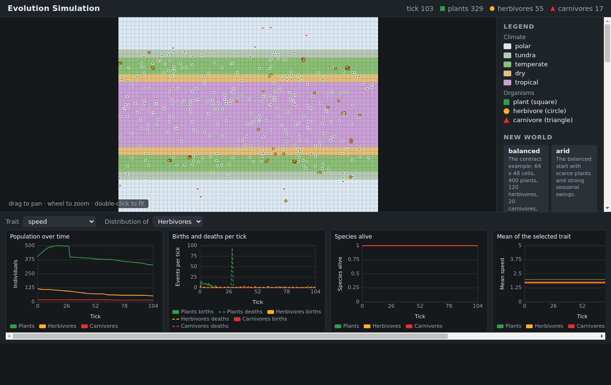
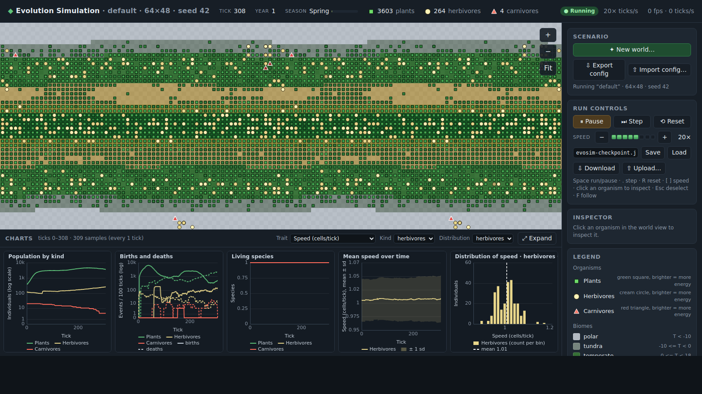
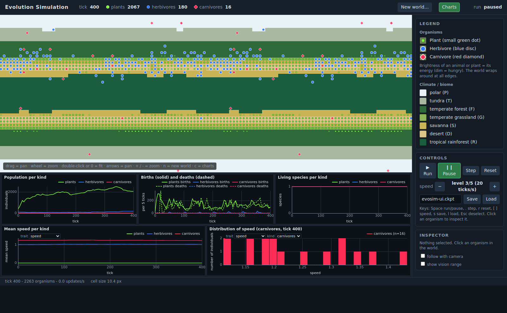
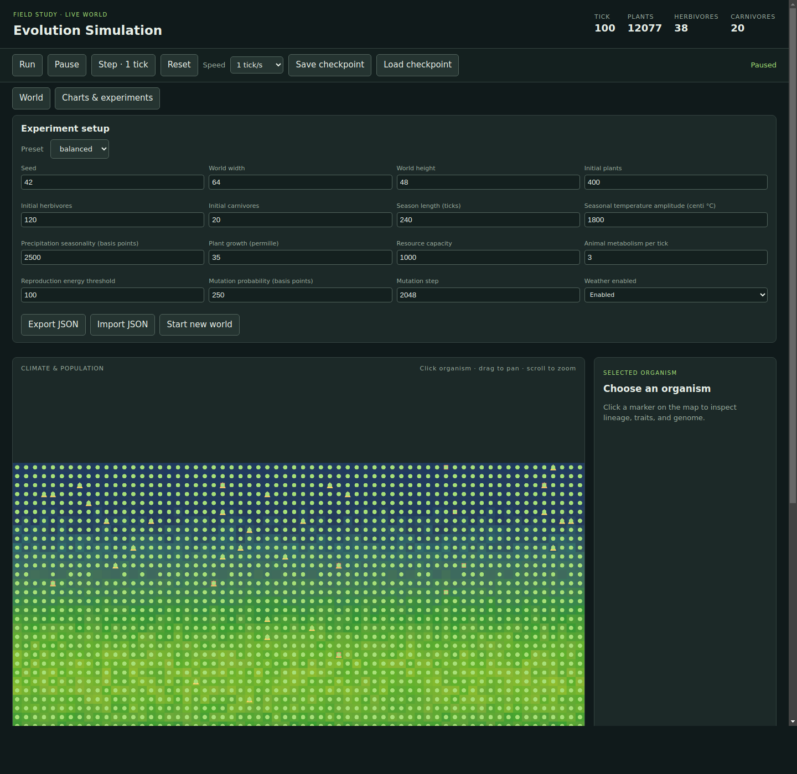
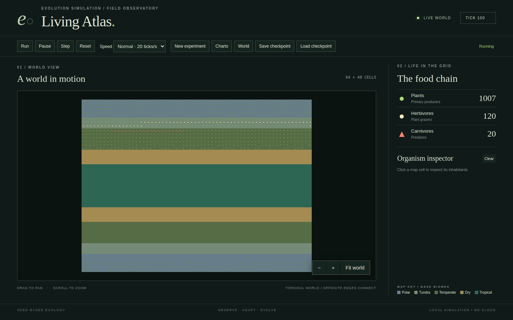
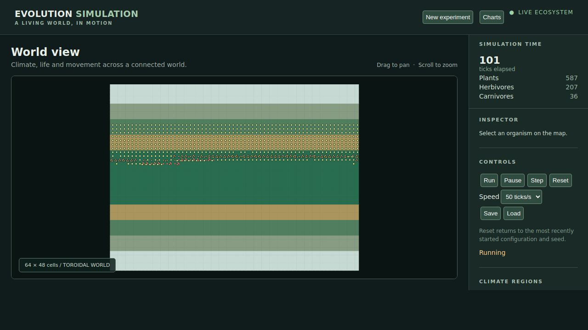

# Evolution Agent Benchmark: results

Published runs of the [Evolution Agent Benchmark](https://github.com/TimoWiesner/Evolution-Sim-Agent-Testground). Each coding agent, cloud or local, gets the same 28 dependent tasks and has to build an evolution simulation from an empty project on its own. Quality is scored by a private black-box test suite the agents never see.

This page is generated; do not edit it by hand.

Written analyses: [ANALYSIS.md](ANALYSIS.md).

7 run(s), 7 version/profile/track combination(s). "—" means the CLI did not report the value; it is never counted as zero. With more than one run, the summary shows the median.

## Summary by version, profile and track

| Version | Track | Profile | Model | Runs | Tasks done | First-cycle pass | Failed phases | Agent time | Fresh input | Cached input | Output | Cost |
|---|---|---|---|---|---|---|---|---|---|---|---|---|
| 1 | sequential | claude-haiku | haiku | 1 | 100% | 86% | 0 | 4h 58m | 9.1M | 185.9M | 3.2M | $12.16 |
| 1 | sequential | claude-opus | opus | 1 | 100% | 100% | 0 | 6h 15m | 6.0M | 102.3M | 1.6M | $100.73 |
| 1 | sequential | claude-sonnet | sonnet | 1 | 100% | 93% | 0 | 3h 42m | 4.0M | 51.6M | 970.9k | $30.76 |
| 1 | sequential | gpt-astra | gpt-6-astra | 1 | 4% | 100% | 0 | 35m 14s | 605.8k | 5.2M | 75.2k | — |
| 1 | sequential | gpt-luna | gpt-6-luna | 1 | 100% | 79% | 0 | 6h 01m | 5.3M | 107.6M | 797.4k | — |
| 1 | sequential | gpt-sol | gpt-6.1-sol | 1 | 100% | 100% | 0 | 6h 44m | 6.1M | 102.2M | 921.2k | — |
| 1 | sequential | gpt-terra | gpt-6.1-terra | 1 | 100% | 93% | 0 | 2h 14m | 3.1M | 30.7M | 306.7k | — |

## Hidden test results

Checks passed out of all checks in the suite, from the latest evaluation of each run. Checks belonging to tasks that are not done yet count as not passed. Speed is measured by the suite at about 2,000 individuals.

| Version | Track | Profile | Run | Evaluated after | All checks | Contract | Determinism | Checkpoints | Ecology | Robustness | Performance | Distributable | UI | Ticks/s | Balance | Demo balance |
|---|---|---|---|---|---|---|---|---|---|---|---|---|---|---|---|---|
| 1 | sequential | claude-haiku | r2 | final | 42/42 | 10/10 | 4/4 | 5/5 | 8/8 | 9/9 | 2/2 | 2/2 | 2/2 | 908.9 | 3 (0%) | 3 (0%) |
| 1 | sequential | claude-opus | r1 | final | 42/42 | 10/10 | 4/4 | 5/5 | 8/8 | 9/9 | 2/2 | 2/2 | 2/2 | 377.9 | 72 (50%) | 100 (100%) |
| 1 | sequential | claude-sonnet | r1 | final | 42/42 | 10/10 | 4/4 | 5/5 | 8/8 | 9/9 | 2/2 | 2/2 | 2/2 | 338.9 | 25 (0%) | 29 (0%; 1 of 6 runs over the time limit) |
| 1 | sequential | gpt-astra | r1 | final | 4/42 | 3/10 | 0/4 | 0/5 | 0/8 | 0/9 | 0/2 | 1/2 | 0/2 | — | — | — |
| 1 | sequential | gpt-luna | r1 | final | 39/42 | 9/10 | 4/4 | 5/5 | 7/8 | 9/9 | 1/2 | 2/2 | 2/2 | 39.1 | 2 (0%) | 12 (0%; 2 of 6 runs over the time limit) |
| 1 | sequential | gpt-sol | r1 | final | 41/42 | 10/10 | 4/4 | 5/5 | 8/8 | 9/9 | 2/2 | 1/2 | 2/2 | 175.9 | 4 (0%) | 12 (0%) |
| 1 | sequential | gpt-terra | r1 | final | 42/42 | 10/10 | 4/4 | 5/5 | 8/8 | 9/9 | 2/2 | 2/2 | 2/2 | 319.0 | 7 (0%) | 6 (0%) |

"Balance" measures how long plants, herbivores and carnivores coexist over 10,000 ticks (0-100, mean share of the run before the first kind dies out; in brackets the share of runs with all three alive at the end; a run that fails counts as 0, runs over the time limit are left out and listed), once in the contract's example configuration with the product's default parameters and once in its own demo scenario. Collapse is allowed by the task, so this is a figure for comparison, not a check.

## Every run

| Version | Track | Profile | Run | State | Done | Blocked | Phases | Failed | Interventions | Agent time | Tokens | Cost | Reported model | CLI | Isolation | Harness |
|---|---|---|---|---|---|---|---|---|---|---|---|---|---|---|---|---|
| 1 | sequential | claude-haiku | r2 | finished | 28/28 | 0 | 99 | 0 | 0 | 4h 58m | 198.2M | $12.16 | claude-haiku-5-5 | 2.1.325 (Claude Code) | container | b0ff236 |
| 1 | sequential | claude-opus | r1 | finished | 28/28 | 0 | 84 | 0 | 0 | 6h 15m | 109.9M | $100.73 | claude-opus-5-5 | 2.1.328 (Claude Code) | container | 60a5ea5 |
| 1 | sequential | claude-sonnet | r1 | finished | 28/28 | 0 | 90 | 0 | 0 | 3h 42m | 56.6M | $30.76 | claude-sonnet-5-5 | 2.1.325 (Claude Code) | container | b0ff236 |
| 1 | sequential | gpt-astra | r1 | finished | 1/28 | 1 (1 review, 0 error) | 15 | 0 | 1 | 35m 14s | 5.8M | — | — | codex-cli 0.164.0 | container | ead9cc0 |
| 1 | sequential | gpt-luna | r1 | finished | 28/28 | 0 | 105 | 0 | 0 | 6h 01m | 113.7M | — | — | codex-cli 0.164.0 | container | df157a1 |
| 1 | sequential | gpt-sol | r1 | finished | 28/28 | 0 | 84 | 0 | 0 | 6h 44m | 109.2M | — | — | codex-cli 0.164.0 | container | f9d460d |
| 1 | sequential | gpt-terra | r1 | finished | 28/28 | 0 | 90 | 0 | 0 | 2h 14m | 34.1M | — | — | codex-cli 0.164.0 | container | df157a1* |

## Notes

- `*` harness had uncommitted changes when the run started.
- Runs used different harness commits; compare with care.
- Runs were made on different hosts; times are not directly comparable.
- "≥" marks sums that lack phases which reported no figure (for example a phase cut off by the time limit before the CLI wrote its totals). Tokens of such Claude phases are counted from their messages where possible; their cost stays unknown.
- Some runs were paused by a provider usage limit; refused calls are repeated and not counted as failures or agent time.
- Some runs met outages (connection, provider, login or local model server); those calls are repeated and not counted as failures or agent time.
- "Blocked" separates tasks whose own review still found open points after the last cycle ("review": the work is there and counts in the final score) from tasks that failed by errors such as timeouts ("error").
- Some runs had operator interventions (`unblock`).

## Runs

- [claude-haiku · sequential · r2](results/claude-haiku/sequential/r2/README.md) · [executable](https://github.com/TimoWiesner/Evolution-Sim-Agent-Results/releases/tag/claude-haiku-sequential-r2)
- [claude-opus · sequential · r1](results/claude-opus/sequential/r1/README.md) · [executable](https://github.com/TimoWiesner/Evolution-Sim-Agent-Results/releases/tag/claude-opus-sequential-r1)
- [claude-sonnet · sequential · r1](results/claude-sonnet/sequential/r1/README.md) · [executable](https://github.com/TimoWiesner/Evolution-Sim-Agent-Results/releases/tag/claude-sonnet-sequential-r1)
- [gpt-astra · sequential · r1](results/gpt-astra/sequential/r1/README.md) · [executable](https://github.com/TimoWiesner/Evolution-Sim-Agent-Results/releases/tag/gpt-astra-sequential-r1)
- [gpt-luna · sequential · r1](results/gpt-luna/sequential/r1/README.md) · [executable](https://github.com/TimoWiesner/Evolution-Sim-Agent-Results/releases/tag/gpt-luna-sequential-r1)
- [gpt-sol · sequential · r1](results/gpt-sol/sequential/r1/README.md) · [executable](https://github.com/TimoWiesner/Evolution-Sim-Agent-Results/releases/tag/gpt-sol-sequential-r1)
- [gpt-terra · sequential · r1](results/gpt-terra/sequential/r1/README.md) · [executable](https://github.com/TimoWiesner/Evolution-Sim-Agent-Results/releases/tag/gpt-terra-sequential-r1)

## Interfaces

The main view of each product, as designed by the agent.

**claude-haiku · sequential · r2**

**claude-opus · sequential · r1**

**claude-sonnet · sequential · r1**

**gpt-luna · sequential · r1**

**gpt-sol · sequential · r1**

**gpt-terra · sequential · r1**

