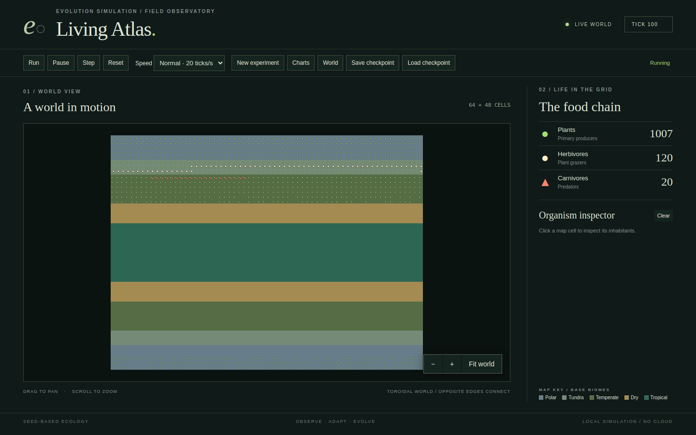
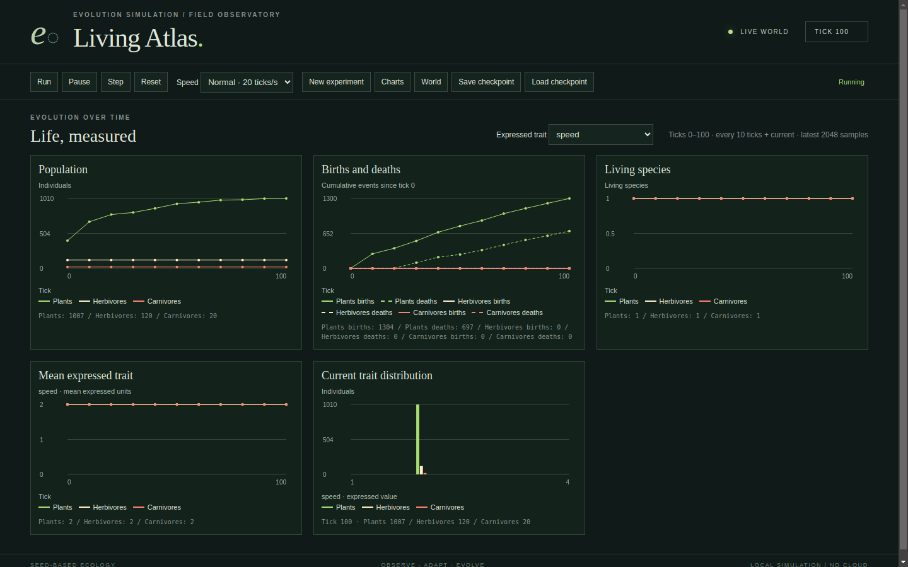
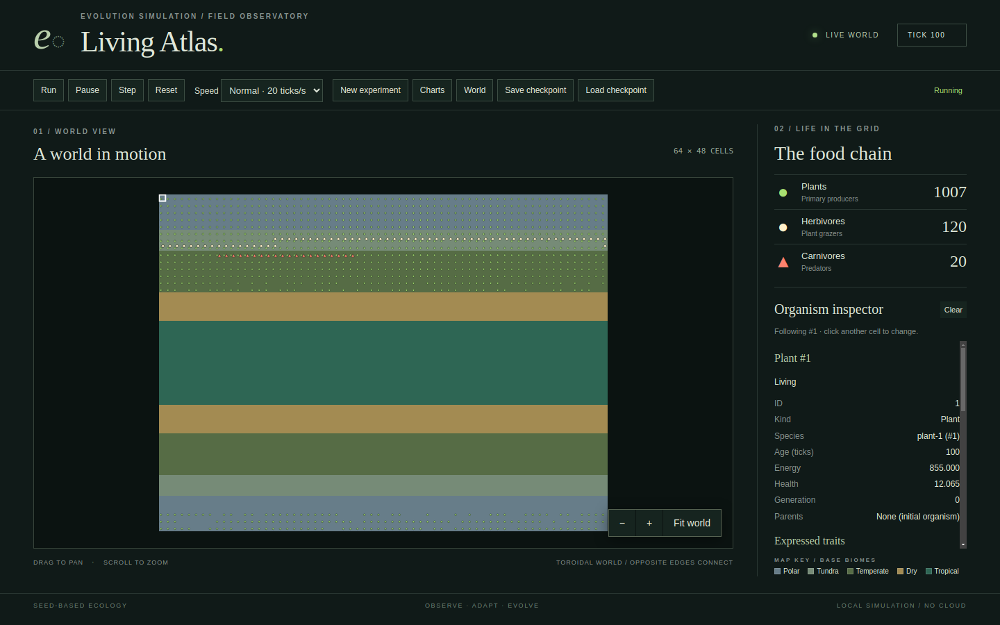

# gpt-sol · sequential · r1

One run of the [Evolution Agent Benchmark](https://github.com/TimoWiesner/Evolution-Sim-Agent-Testground): a coding agent builds an evolution simulation from an empty project across 28 dependent tasks, with no human help.

|  |  |
|---|---|
| Model | gpt-6.1-sol |
| Agent CLI | codex-cli 0.164.0 |
| Track | sequential |
| Benchmark version | 1 |
| Started | 2026-11-20 |
| State | finished |
| Tasks done | 28 of 28 (0 blocked) |
| Passed review in first cycle | 100% |
| Phases attempted / failed | 84 / 0 |
| Operator interventions | 0 |
| Agent time | 6h 44m |
| Tokens (fresh input / cached input / output) | 6.1M / 102.2M / 921.2k |
| Cost | — |
| Isolation | container |

## Hidden test results

Scored by a private black-box suite the agent never saw, at the end of the run, including the work on blocked tasks: **41 of 42 checks passed**.

| Category | Passed | Checks |
|---|---|---|
| Contract | 10 | 10 |
| Determinism | 4 | 4 |
| Checkpoints | 5 | 5 |
| Ecology | 8 | 8 |
| Robustness | 9 | 9 |
| Performance | 2 | 2 |
| Distributable | 1 | 2 |
| UI | 2 | 2 |

Measured speed: 175.9 ticks per second at about 2,000 individuals.

Balance (how long plants, herbivores and carnivores coexist over 10,000 ticks; 0-100, in brackets the share of runs with all three alive at the end; a failed run counts as 0, runs over the time limit are left out and listed): example configuration 4 (0%), the product's demo scenario 12 (0%). Collapse is allowed, so this is not a pass/fail check.

### Progress over the run

| After | Tasks done | Checks passed | Checks due |
|---|---|---|---|
| TASK-001 | 1 | 0 | 0 |
| TASK-002 | 2 | 4 | 4 |
| TASK-003 | 3 | 4 | 4 |
| TASK-004 | 4 | 4 | 4 |
| TASK-005 | 5 | 4 | 4 |
| TASK-006 | 6 | 4 | 4 |
| TASK-007 | 7 | 4 | 4 |
| TASK-008 | 8 | 4 | 4 |
| TASK-009 | 9 | 4 | 4 |
| TASK-010 | 10 | 4 | 4 |
| TASK-011 | 11 | 4 | 4 |
| TASK-012 | 12 | 4 | 4 |
| TASK-013 | 13 | 4 | 4 |
| TASK-014 | 14 | 4 | 4 |
| TASK-015 | 15 | 4 | 4 |
| TASK-016 | 16 | 4 | 4 |
| TASK-017 | 17 | 4 | 4 |
| TASK-018 | 18 | 4 | 4 |
| TASK-019 | 19 | 31 | 32 |
| TASK-020 | 20 | 31 | 32 |
| TASK-021 | 21 | 32 | 33 |
| TASK-022 | 22 | 37 | 38 |
| TASK-023 | 23 | 39 | 40 |
| TASK-024 | 24 | 39 | 40 |
| TASK-025 | 25 | 39 | 40 |
| TASK-026 | 26 | 40 | 41 |
| TASK-027 | 27 | 41 | 41 |
| TASK-028 | 28 | 41 | 42 |
| final | 28 | 41 | 42 |

## User interface

Screenshots written by the product itself (`./evosim ui --screenshots`). The tasks fix what the interface must be able to do; its design was the agent's own choice.

## Download

- Executable (Linux x86-64): `evosim-gpt-sol-sequential-r1-linux-x86_64.tar.gz` on the [release page](https://github.com/TimoWiesner/Evolution-Sim-Agent-Results/releases/tag/gpt-sol-sequential-r1). It is self-contained: it ran on a bare Ubuntu 24.04 with no runtimes installed.
  SHA-256 `b21f6100f12028ee79ec619bd27488af75ad2d8b9561337f93ba0ab8d0687327`, 0.9 MB.
  Unpack it, then run `./evosim version`, `./evosim ui` or `./evosim run --help`.
- [`source.zip`](source.zip): the final project exactly as the agent left it, including its plans, reviews and handoff notes under `tasks/*/handoffs/`.
- [`report.json`](report.json): all figures above in machine-readable form, plus per-task numbers.

> The code in this folder was written by an AI agent without human review. Run it at your own risk.
